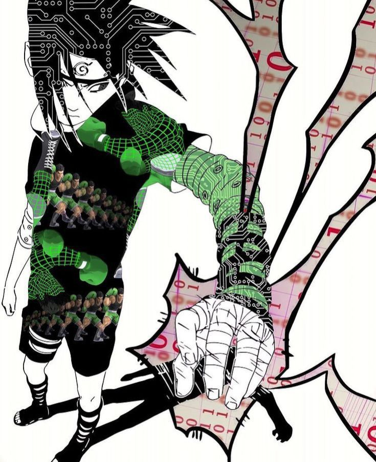

<h1 align="center">Hola, soy <a href="https://github.com/octocat">Julio</a></h1>

  
  
  
  

<h2>Sobre mí</h2>

Desarrollador de software en formación en la Universidad Tecnológica de Torreón. Egresé del TSU en Desarrollo de Software en agosto de 2026 y continúo hacia la Ingeniería en Tecnologías de la Información e Innovación Digital.

<table>
  <tr><td><b>Formación</b></td><td>TSU en Desarrollo de Software · Universidad Tecnológica de Torreón</td></tr>
  <tr><td><b>Egreso</b></td><td>Agosto 2026</td></tr>
  <tr><td><b>Siguiente paso</b></td><td>Ingeniería en Tecnologías de la Información e Innovación Digital</td></tr>
  <tr><td><b>Ubicación</b></td><td>Torreón, México</td></tr>
</table>

<h2>Tecnologías</h2>
<h3>Lenguajes</h3>

  
  
  
  
  
  

<h3>Frameworks / librerías</h3>

  
  
  

<h3>Bases de datos</h3>

  
  
  

<h3>Herramientas y entornos</h3>

  
  
  
  
  
  
  
  

<h2>Estadísticas</h2>

  
  

